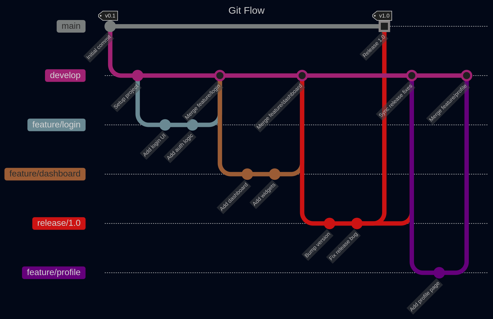
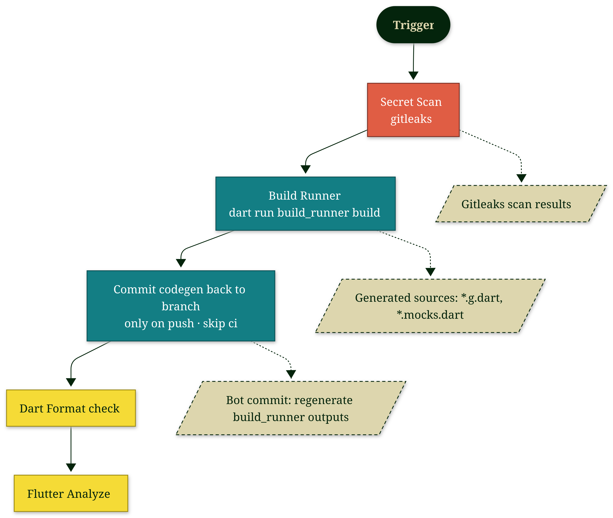
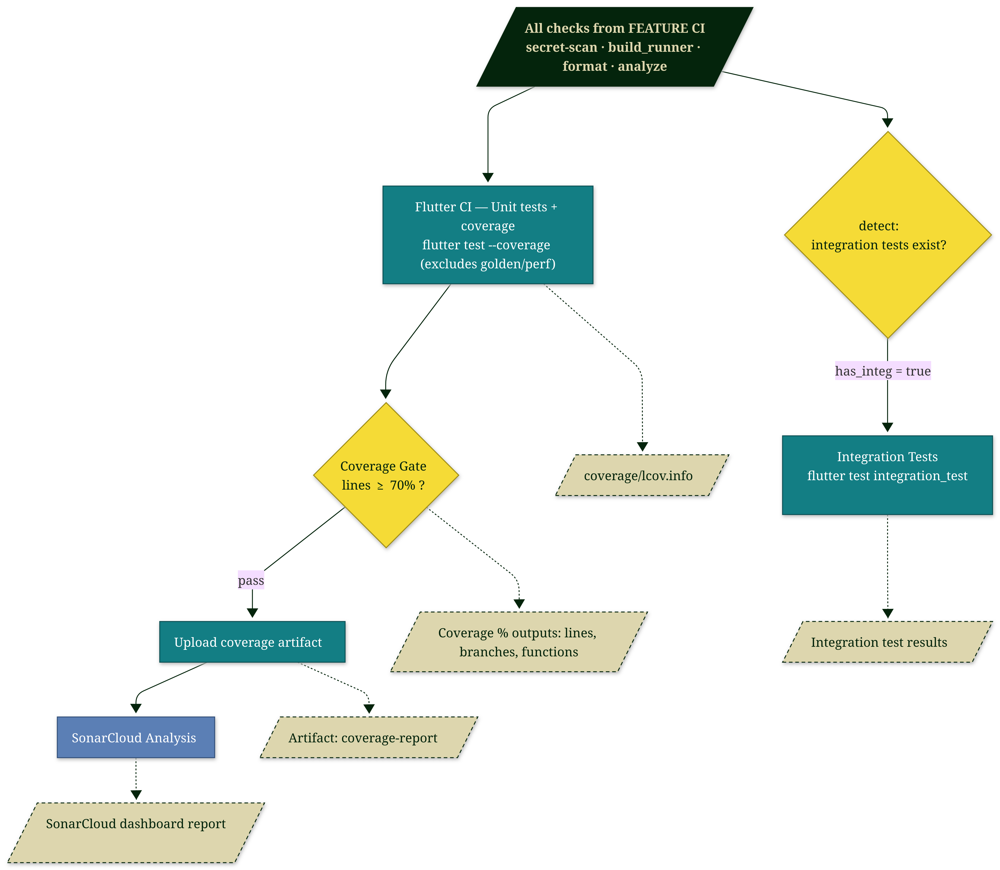
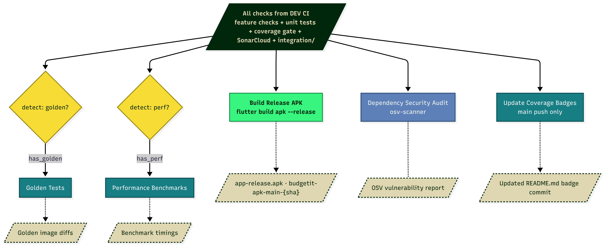

<div align="center">

---

<div align="center">

## BudgetIt

</div>

A mobile budgeting app designed to help users track income and expenses, manage budgets, import bank statements, and understand their spending through reports and insights.

---

## Quick Links

</div>

<div align="center">

| Quick Links |
| :---: |
| [Software Requirements Specification (SRS)](docs/SRS.md) |
| [Software Architecture Specification (SAS)](docs/SAS.md) |
| [Brand Style Guide](docs/designs/Brand_Style/brandstyle.md) |
| [Coding Standards](docs/CodingStandards.pdf) |
| [User Manual](docs/UserManualDemo4.pdf) |
| [Testing Policy](docs/TestingPolicy.md) |
| [Service Contracts](docs/ServiceContracts.md) |
| [Landing Page](https://cos301-se-2026.github.io/Mobile-Budgeting-App/) |
| [Developer Guide](#developer-guide) |
| [Build and Installation](#build-and-installation) |
| [Project Board](https://github.com/COS301-SE-2026/Mobile-Budgeting-App/projects) |
| [NFR Testing Guide](#nfr-testing-guide) |

</div>

---

<div align="center">

## Team

</div>

<p align="center">
  
</p>

<div align="center">

| Member | Role | Profiles |
| :----------------- | :----------------------------- | :----------------------------------------------------------------------------------------------------------------------------------------------------------------: |
| **Pavan Naidoo**   | Scrum Master & Full-Stack Lead |  [](https://www.linkedin.com/in/pavan-naidoo-5333613b5/) [](https://github.com/PavthePekka) |
| **Lufuno Mphagi**  | Backend & Data Lead            |      [](https://www.linkedin.com/in/lufuno-mphagi/) [](https://github.com/LufunoMphagi) |
| **Kiolin Gounden** | AI & Analytics Lead            | [](https://www.linkedin.com/in/kiolin-gounden-10577924b/) [](https://github.com/ok-kiolin) |
| **Jessica Marodi** | Frontend Lead & UI/UX          |   [](https://www.linkedin.com/in/jessica-m-9722a3380/) [](https://github.com/JessicaM-coder) |
| **Donovan Nelson** | DevOps & Infrastructure        |      [](https://www.linkedin.com/in/donovan-nelson/) [](https://github.com/Do-nny) |

</div>


---

<div align="center">

## Tech Stack

</div>

<div align="center">

#### Web

</div>

<p align="center">
  
</p>

<div align="center">

#### Mobile

</div>

<p align="center">
  
  
</p>

<div align="center">

#### Backend

</div>

<p align="center">
  
  
  
  
</p>

<div align="center">

#### Database and Infrastructure

</div>

<p align="center">
  
  
  
  
  
</p>

---

<div align="center">

## Project Status

</div>

<div align="center">

#### Milestones

</div>

<p align="center">
  
</p>

<div align="center">

#### Issues

</div>

<p align="center">
  
</p>

<div align="center">

#### CI

</div>

<p align="center">
  <a href="https://github.com/COS301-SE-2026/Mobile-Budgeting-App/actions/workflows/ci-main.yml"></a>
  <a href="https://github.com/COS301-SE-2026/Mobile-Budgeting-App/actions/workflows/ci-dev.yml"></a>
</p>

<div align="center">

#### Quality

</div>

<p align="center">
  
</p>

<div align="center">

#### Coverage

</div>

<p align="center">
  <a href="https://app.codecov.io/gh/COS301-SE-2026/Mobile-Budgeting-App/tree/main"></a>
  <a href="https://app.codecov.io/gh/COS301-SE-2026/Mobile-Budgeting-App/tree/newdev"></a>
</p>

<p align="center">
  <a href="https://app.codecov.io/gh/COS301-SE-2026/Mobile-Budgeting-App"></a>
</p>

---

<div align="center">

## Developer Guide

</div>

<div align="center">

### Build and Installation

</div>

Container-based setup is recommended. Use the linked guides for prerequisites, configuration, and platform-specific steps.

| Component | Container setup (recommended) | Manual setup |
| :--- | :--- | :--- |
| Flutter | [Container guide](docs/setup/flutter-container-setup.md) | [Manual guide](docs/setup/flutter-manual-setup.md) |
| Backend | [Container guide](docs/setup/backend-container-setup.md) | [Manual guide](docs/setup/backend-manual-setup.md) |

#### Flutter quick start

```sh
make -C docker flutter-build-image
make -C docker flutter-test
```

#### Backend quick start

```sh
make -C docker backend-up
curl http://localhost:8000/health
```

<div align="center">

### Branching Strategy

</div>



<div align="center">

### CI/CD

</div>

<!-- The four CI/CD diagrams below retain the supplied README paths. These files were not present on main when checked; add them at these paths or update the paths before publishing. -->

<details>
<summary>Feature Branches</summary>



</details>

<details>
<summary>Dev Branch</summary>



</details>

<details>
<summary>Main Branch</summary>



</details>

<details>
<summary>Full Flow</summary>


</details>

---

<div align="center">

## NFR Testing Guide

</div>

How to run the manual / tool-assisted tests for the non-functional requirements
(NFRs) defined in [`docs/SAS.md`](docs/SAS.md) §2.5.
Evidence: [`docs/assets/nfr/`](docs/assets/nfr).

| ID | Requirement (quantified) | Tool | Target |
|----|--------------------------|------|--------|
| QR-01 | 95% of `/powersync/upload` complete within 400 ms under 50 concurrent users | Locust | p95 < 400 ms |
| QR-02 | Error rate stays below 1% at peak load | Locust (same run) | < 1% errors |
| QR-03 | System recovers from a backend outage with zero data loss | `docker compose` + Flutter app | 0 lost writes |
| QR-05 | All traffic encrypted in transit; internal services not publicly reachable | `curl` + `openssl` | Direct port refused + valid TLS |
| QR-07 | ≥80% automated coverage; deployable within 2 hours | SonarCloud/Codecov + timed rollback | ≥80% + <2 h |

---

<details>
<summary>Full NFR test procedures</summary>

## QR-01 & QR-02 — Load / Performance & Reliability

Both are measured in a **single** Locust run against `POST /powersync/upload`,
the write path PowerSync uses to flush a device's CRUD queue to the database.

### Prerequisites

- `uv` (already used by the backend).
- A valid AWS Cognito **ID/access token** for a registered user
  (required — the endpoint rejects requests without a valid JWT).

### Setup (once)

```bash
cd loadtest
uv sync            # creates .venv and installs Locust (from pyproject.toml + uv.lock)
```

### Run

```bash
cd loadtest
uv run locust -f locustfile.py \
    --host https://api.<your-domain> \
    --users 50 --spawn-rate 10 --run-time 5m \
    --token "$BUDGETIT_TOKEN" \
    --headless --csv results/run
```

- `--users 50` → the "50 concurrent users" from QR-01.
- `--host` → your Caddy route (`api.16.28.126.118.sslip.io` per `docker/backend/Caddyfile`)
  or `http://localhost:8000` for local runs.
- `--token` → the Cognito JWT (or export `BUDGETIT_TOKEN`). Without it every request
  returns 401 and QR-02 will fail.
- `--batch-min` / `--batch-max` → optional; control CRUD ops per request (default 1–5).

### Reading the result

At the end of the run the test prints a summary:

```
================ QR-01 / QR-02 RESULT ================
Requests        : 12345
Failures        : 12
Avg / p95 / p99 : 62.0 ms / 145.0 ms / 290.0 ms
Error rate      : 0.10%
QR-01 (p95 < 400 ms @ 50 users): PASS
QR-02 (error rate < 1.0%): PASS
======================================================
```

- **QR-01 passes** if `p95 < 400 ms` at 50 users.
- **QR-02 passes** if the error rate is `< 1%`.

> Note: the JWT is validated against Cognito's JWKS on every request (cached after
> the first). A short warm-up or a `--spawn-rate` ramp avoids the first-lookup cost
> skewing the p95.

---

## QR-03 — Fault Tolerance / Zero Data Loss (backend outage)

Simulates a backend outage while a user keeps writing locally, then verifies the
offline-first queue drains with no lost rows.

### Steps

```bash
# 1. Note the current row count (optional, for the "zero loss" check)
#    e.g. via psql against RDS:  SELECT count(*) FROM transactions;

# 2. Stop the backend (run from docker/backend/)
docker compose stop backend-api

# 3. In the Flutter app (logged in), add transactions while the backend is down.
#    The app stays usable — writes are queued locally (sync status shows Offline/Syncing).

# 4. Restore the backend
docker compose start backend-api

# 5. Watch the app: sync status should return to "Up to date" once the queue drains.
```

> For the **production** stack, use both compose files:
> `docker compose -f docker-compose.yml -f docker-compose.prod.yml stop backend-api`
> (same for `start`).

### How to confirm zero data loss

1. Record the transaction count **before** stopping the backend.
2. Make a known number of local writes (e.g. 5 transactions) while it is down.
3. After restart and the app reports "Up to date", check the count again:

   ```sql
   SELECT count(*) FROM transactions;
   ```

4. The count must equal `before + 5`, with no missing or duplicate rows.

- **QR-03 passes** if every queued write lands in the database (0 lost writes).
- If the count is short, the queue did not drain; if higher, writes were duplicated.

---

## QR-05 — Security / Network Exposure (TLS + closed ports)

Two checks: the backend must **not** be reachable directly, and the public HTTPS
route must present a valid certificate.

```bash
# (a) Should REFUSE / time out — backend-api is not directly exposed
curl -v http://<ec2-elastic-ip>:8000/health

# (b) Should SUCCEED with valid TLS (200 {"status":"ok"})
curl -v https://api.<your-domain>/health

# (c) Should show a valid cert (issuer: Let's Encrypt; CN/SAN matches api.<your-domain>)
openssl s_client -connect api.<your-domain>:443 -brief
```

- **QR-05 passes** when (a) refuses/timeouts, (b) returns `200`, and (c) reports a
  valid certificate for the domain.
- Rationale (from SAS §2.5): the EC2 security group only exposes 80/443; the Caddy
  reverse proxy terminates TLS and routes to `backend-api:8000` / `powersync:8080`,
  which must stay unreachable from the public internet.

---

## QR-07 — Maintainability (coverage + rollback)

### Coverage (≥80%)

Coverage is produced automatically by CI — no new test is needed. Screenshot the
coverage percentage from the **SonarCloud** project dashboard (or **Codecov**, which
the `coverage-gate` workflow uploads to) and record it as evidence.

- **QR-07 (coverage) passes** if the reported coverage is **≥80%**.

### Rollback (deployable within 2 hours)

Once CI is producing SHA-tagged backend images (SAS §5.4, steps 11–12), rollback is a
single pull-and-recreate. Run this **on EC2**, from `docker/backend/`:

```bash
time (docker compose -f docker-compose.yml -f docker-compose.prod.yml pull && \
      docker compose -f docker-compose.yml -f docker-compose.prod.yml up -d)
```

- First point the `backend-api` service at the **previous SHA-tagged image**
  (set it in `.env.prod` / the compose `image:` field) so `pull` fetches the older tag.
- `time` records the wall-clock duration of the rollback.

- **QR-07 (rollback) passes** if the redeploy completes in well under **2 hours**
  (in practice this should be seconds-to-minutes).

</details>
