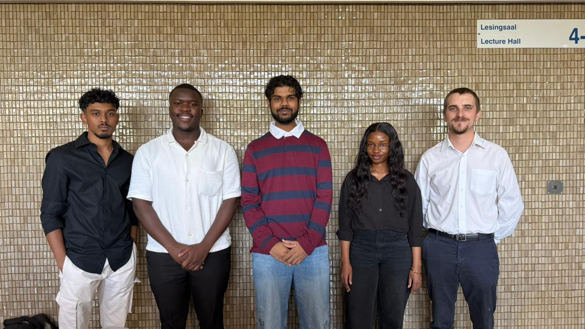

<div align="center">


</div>
<div align="center">

---

<div align="center">

## BudgetIt

</div>

A mobile budgeting app designed to help users track income and expenses, manage budgets, import bank statements, and understand their spending through reports and insights.

---

## Quick Links

</div>

<div align="center">

| Quick Links |
| :---: |
| [Software Requirements Specification (SRS)](docs/SRS.md) |
| [Software Architecture Specification (SAS)](docs/SAS.md) |
| [Brand Style Guide](docs/designs/Brand_Style/brandstyle.md) |
| [Coding Standards](docs/CodingStandards.pdf) |
| [User Manual](docs/UserManualDemo4.pdf) |
| [Testing Policy](docs/TestingPolicy.md) |
| [Service Contracts](docs/ServiceContracts.md) |
| [Landing Page](https://cos301-se-2026.github.io/Mobile-Budgeting-App/) |
| [Developer Guide](#developer-guide) |
| [Build and Installation](#build-and-installation) |
| [Project Board](https://github.com/COS301-SE-2026/Mobile-Budgeting-App/projects) |
| [NFR Testing Guide](docs/NFR_Testing_Guide.md) |

</div>

---

<div align="center">

## Team

</div>

<p align="center">
  
</p>

<div align="center">

| Member | Role | Profiles |
| :----------------- | :----------------------------- | :----------------------------------------------------------------------------------------------------------------------------------------------------------------: |
| **Pavan Naidoo**   | Scrum Master & Full-Stack Lead |  [](https://www.linkedin.com/in/pavan-naidoo-5333613b5/) [](https://github.com/PavthePekka) |
| **Lufuno Mphagi**  | Backend & Data Lead            |      [](https://www.linkedin.com/in/lufuno-mphagi/) [](https://github.com/LufunoMphagi) |
| **Kiolin Gounden** | AI & Analytics Lead            | [](https://www.linkedin.com/in/kiolin-gounden-10577924b/) [](https://github.com/ok-kiolin) |
| **Jessica Marodi** | Frontend Lead & UI/UX          |   [](https://www.linkedin.com/in/jessica-m-9722a3380/) [](https://github.com/JessicaM-coder) |
| **Donovan Nelson** | DevOps & Infrastructure        |      [](https://www.linkedin.com/in/donovan-nelson/) [](https://github.com/Do-nny) |

</div>


---

<div align="center">

## Tech Stack

</div>

<p align="center">
  
  
  
  
</p>

<p align="center">
  
  
  
  
  
</p>

<p align="center">
  
  
</p>

---

<div align="center">

## Project Status

</div>

<p align="center">
  <a href="https://github.com/COS301-SE-2026/Mobile-Budgeting-App/actions/workflows/ci-main.yml"></a>
  <a href="https://github.com/COS301-SE-2026/Mobile-Budgeting-App/actions/workflows/ci-dev.yml"></a>
  <br />
  
  <br />
  <a href="https://app.codecov.io/gh/COS301-SE-2026/Mobile-Budgeting-App/tree/main"></a>
  <a href="https://app.codecov.io/gh/COS301-SE-2026/Mobile-Budgeting-App/tree/newdev"></a>
  <br />
  <a href="https://app.codecov.io/gh/COS301-SE-2026/Mobile-Budgeting-App"></a>
</p>

---

<div align="center">

## Developer Guide

</div>

<div align="center">

### Build and Installation

</div>

Container-based setup is recommended. Use the linked guides for prerequisites, configuration, and platform-specific steps.

| Component | Container setup (recommended) | Manual setup |
| :--- | :--- | :--- |
| Flutter | [Container guide](docs/setup/flutter-container-setup.md) | [Manual guide](docs/setup/flutter-manual-setup.md) |
| Backend | [Container guide](docs/setup/backend-container-setup.md) | [Manual guide](docs/setup/backend-manual-setup.md) |

#### Flutter quick start

```sh
make -C docker flutter-build-image
make -C docker flutter-test
```

#### Backend quick start

```sh
make -C docker backend-up
curl http://localhost:8000/health
```


</div>

